# Entity Relationship (ER) Diagram & Data Architecture

## 1. System Overview
The **Multi-Tenant Event & Ticket Reservation System** is designed for high-concurrency event ticketing with pessimistic inventory locking, multi-tenant data isolation, role-based access control (RBAC), Redis-backed read caching, and automated hold expiration.

---

## 2. Mermaid ER Diagram

```mermaid
erDiagram
    TENANTS ||--o{ USERS : "employs / scopes"
    TENANTS ||--o{ EVENTS : "hosts / owns"
    TENANTS ||--o{ ORDERS : "collects revenue for"

    USERS ||--o{ EVENTS : "creates (Organizers)"
    USERS ||--o{ RESERVATIONS : "places hold (Attendees)"
    USERS ||--o{ ORDERS : "places (Attendees)"

    EVENTS ||--|{ TICKET_TIERS : "offers"
    EVENTS ||--o{ RESERVATIONS : "reserves seats for"
    EVENTS ||--o{ ORDERS : "associated with"

    TICKET_TIERS ||--o{ RESERVATIONS : "temporarily holds"
    TICKET_TIERS ||--o{ ORDER_ITEMS : "issues ticket for"

    RESERVATIONS ||--o| ORDERS : "converts into"

    ORDERS ||--|{ ORDER_ITEMS : "contains"
    ORDERS ||--|{ TRANSACTIONS : "settled via"

    TENANTS {
        string id PK "Unique Tenant ID (e.g. tenant-apex)"
        string name "Organization Name"
        string slug UK "URL identifier (e.g. apex-tech)"
        string domain "Custom Domain"
        string logo_url "Branding Logo"
        string currency "ISO Currency (USD)"
        datetime created_at "Registration Timestamp"
    }

    USERS {
        string id PK "Unique User UUID"
        string tenant_id FK "References TENANTS.id (NULL for Admin/Attendee)"
        string email UK "Unique Email Address"
        string password_hash "Bcrypt Hashed Password"
        string full_name "User Display Name"
        string role "admin | organizer | attendee"
        string avatar_url "Profile Photo URL"
        datetime created_at "Account Creation Timestamp"
    }

    EVENTS {
        string id PK "Unique Event UUID"
        string tenant_id FK "References TENANTS.id (Tenant Scoping)"
        string title "Event Title"
        string description "Detailed Markdown Description"
        string category "Category (Tech, Music, Arts)"
        string venue "Physical or Virtual Venue"
        string banner_url "High-Res Event Poster"
        datetime event_date "Date and Time of Event"
        datetime sales_cutoff_date "Ticket Sales Deadline"
        string status "DRAFT | PUBLISHED | SOLDOUT | CANCELLED"
        string created_by FK "References USERS.id"
        datetime created_at "Creation Timestamp"
        datetime updated_at "Last Modified Timestamp"
    }

    TICKET_TIERS {
        string id PK "Unique Tier UUID"
        string event_id FK "References EVENTS.id"
        string name "Tier Name (VIP, General Admission)"
        string description "Tier Inclusions"
        decimal price "Ticket Price in Tenant Currency"
        int total_quantity "Total Tier Capacity"
        int reserved_quantity "Seats under 10-minute hold"
        int sold_quantity "Confirmed Purchased Seats"
        int max_per_order "Max quantity limit per checkout"
        string perks "Perks list (Lounge access, drinks)"
        datetime created_at "Creation Timestamp"
    }

    RESERVATIONS {
        string id PK "Unique Hold UUID (res-xxx)"
        string event_id FK "References EVENTS.id"
        string ticket_tier_id FK "References TICKET_TIERS.id"
        string user_id FK "References USERS.id (Optional for guest)"
        string session_id "Client Hold Session Token"
        int quantity "Number of Seats Held"
        decimal unit_price "Lock-in Ticket Price"
        decimal total_amount "Total Hold Value"
        string status "HELD | COMPLETED | EXPIRED | CANCELLED"
        datetime expires_at "Expiration (NOW + 10 Minutes)"
        datetime created_at "Hold Creation Timestamp"
    }

    ORDERS {
        string id PK "Unique Order UUID (ord-xxx)"
        string tenant_id FK "References TENANTS.id"
        string event_id FK "References EVENTS.id"
        string user_id FK "References USERS.id"
        string reservation_id FK "References RESERVATIONS.id"
        string order_number UK "Human Readable ID (ORD-2026-XXXXX)"
        decimal total_amount "Gross Total Paid"
        string status "PENDING | CONFIRMED | CANCELLED | REFUNDED"
        string attendee_name "Primary Ticket Holder Name"
        string attendee_email "Notification Email"
        datetime created_at "Order Completion Timestamp"
    }

    ORDER_ITEMS {
        string id PK "Unique Ticket Item UUID"
        string order_id FK "References ORDERS.id"
        string ticket_tier_id FK "References TICKET_TIERS.id"
        string ticket_code UK "Unique Ticket Voucher (TKT-VIP-XXXXX)"
        string tier_name "Snapshot of Tier Name"
        decimal price "Historical Purchase Price"
        string status "ACTIVE | CHECKED_IN | CANCELLED"
        string qr_payload "Cryptographic/Verification Payload"
        datetime created_at "Issue Timestamp"
    }

    TRANSACTIONS {
        string id PK "Transaction UUID"
        string order_id FK "References ORDERS.id"
        string transaction_ref UK "Gateway Auth Reference"
        string payment_method "CREDIT_CARD | UPI | WALLET"
        decimal amount "Charged Amount"
        string currency "Currency (USD)"
        string status "PENDING | SUCCEEDED | FAILED"
        string failure_reason "Gateway Decline Code / Reason"
        string idempotency_key UK "Unique Key to prevent double charges"
        string gateway_response "Raw Gateway Simulation Response"
        datetime created_at "Payment Processed Timestamp"
    }
```



---

## 3. Data Dictionary & Relational Integrity

### Critical Inventory Integrity Invariant
At every point in time across all transactions:
$$\text{reserved\_quantity} + \text{sold\_quantity} \le \text{total\_quantity}$$
$$\text{available\_quantity} = \text{total\_quantity} - (\text{reserved\_quantity} + \text{sold\_quantity})$$

### Row-Level Locking Protocol (Anti-Double-Booking)
```sql
-- PostgreSQL Transaction
BEGIN;
SELECT id, total_quantity, reserved_quantity, sold_quantity, price
FROM ticket_tiers
WHERE id = $1 AND event_id = $2
FOR UPDATE;

-- Validates: (total_quantity - (reserved_quantity + sold_quantity)) >= requested_quantity
UPDATE ticket_tiers
SET reserved_quantity = reserved_quantity + $qty
WHERE id = $1;

INSERT INTO reservations (..., expires_at)
VALUES (..., NOW() + INTERVAL '10 minutes');
COMMIT;
```

### Automatic TTL Expiration Protocol
The background worker runs periodically every 10 seconds:
```sql
BEGIN;
SELECT id, event_id, ticket_tier_id, quantity
FROM reservations
WHERE status = 'HELD' AND expires_at <= NOW()
FOR UPDATE;

UPDATE ticket_tiers
SET reserved_quantity = GREATEST(0, reserved_quantity - $quantity)
WHERE id = $ticket_tier_id;

UPDATE reservations
SET status = 'EXPIRED'
WHERE id = $id;
COMMIT;
```
